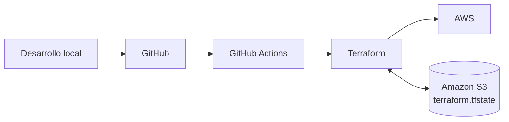
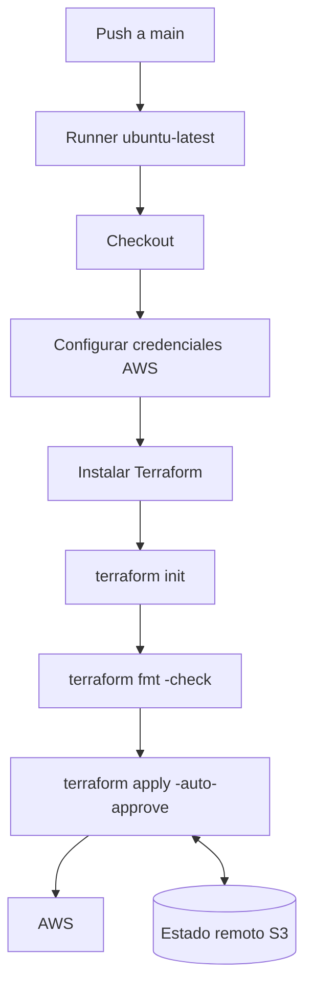

# Pipeline CI/CD de Terraform con GitHub Actions y AWS

Proyecto práctico de **Infrastructure as Code (IaC)** en el que se aprovisiona infraestructura en AWS mediante Terraform y se automatiza su ejecución con GitHub Actions.

El proyecto cubre el ciclo completo: autenticación, backend remoto en Amazon S3, definición de infraestructura mediante módulos, validación del despliegue en AWS, publicación del código en GitHub y creación de un pipeline CI/CD.

> **Objetivo principal:** disponer de un flujo reproducible en el que cada cambio enviado a `main` pueda inicializar Terraform, validar el formato y aplicar automáticamente la infraestructura sobre AWS.

---

## Índice

1. [Arquitectura del proyecto](#arquitectura-del-proyecto)
2. [Autenticación inicial en AWS](#1-autenticación-inicial-en-aws)
3. [Backend remoto en Amazon S3](#2-backend-remoto-en-amazon-s3)
4. [Provider de AWS](#3-configuración-del-provider-de-aws)
5. [Inicialización de Terraform](#4-inicialización-de-terraform)
6. [Configuración del backend](#5-configuración-del-backend-s3)
7. [Creación de la VPC mediante módulos](#6-creación-de-la-vpc-mediante-módulos)
8. [Plan y despliegue](#7-validación-y-despliegue-de-la-infraestructura)
9. [Comprobación en AWS](#8-comprobación-de-los-recursos-en-aws)
10. [Preparación del repositorio](#9-preparación-del-repositorio-github)
11. [Creación del workflow](#10-creación-del-workflow-de-github-actions)
12. [Versionado de Actions](#11-revisión-de-versiones-de-las-actions)
13. [Credenciales AWS](#12-autenticación-de-github-actions-con-aws)
14. [OIDC e IAM](#13-enfoque-recomendado-oidc--iam)
15. [Repository Secrets](#14-solución-utilizada-github-actions-secrets)
16. [Ejecución del pipeline](#15-ejecución-y-validación-del-pipeline)
17. [Workflow final](#workflow-final)
18. [Estructura del proyecto](#estructura-del-proyecto)
19. [Conclusiones y mejoras](#conclusiones-y-mejoras)

---

# Arquitectura del proyecto



Terraform administra la infraestructura de AWS y utiliza un **backend remoto en Amazon S3** para guardar el estado. GitHub Actions actúa como motor de automatización: cuando se realiza un `push` a `main`, se ejecuta el workflow y Terraform trabaja contra el mismo estado remoto.

---

# 1. Autenticación inicial en AWS

Para comenzar se realiza la autenticación desde AWS CLI con el perfil de estudiante:

```powershell
aws login --profile estudiante
```

El perfil permite trabajar desde el entorno local sin introducir credenciales directamente en los archivos `.tf`.

Una comprobación habitual de la sesión es:

```powershell
aws sts get-caller-identity --profile estudiante
```

> Si se ejecuta el comando sin `--profile estudiante` y no existe un perfil por defecto, AWS CLI puede devolver `Unable to locate credentials`.

---

# 2. Backend remoto en Amazon S3

Terraform utiliza el archivo `terraform.tfstate` para mantener una representación del estado de la infraestructura que gestiona.

Guardar este archivo únicamente en local no es adecuado para un pipeline porque los runners de GitHub Actions son efímeros. Por tanto, el estado se almacena de forma remota en **Amazon S3**.

## 2.1 Creación del bucket

Se crea un bucket S3 de uso general en la región:

```text
eu-west-1 — Europa (Irlanda)
```


Se configura el bucket para utilizarlo exclusivamente como backend de Terraform.


El nombre definitivo utilizado es:

```text
terraform-pipeline-demo-tfstate-project
```


## 2.2 Versionado

Se habilita el **control de versiones** del bucket.


Esto permite conservar versiones anteriores del estado. Si el objeto `terraform.tfstate` se elimina o se sobrescribe de forma incorrecta, S3 mantiene un historial que puede ayudar a recuperarlo.

> El versionado no sustituye una estrategia de backup completa, pero añade una capa de protección muy útil para el estado remoto.

---

# 3. Configuración del provider de AWS

Se consulta el **Terraform Registry** para utilizar el provider oficial de AWS y comprobar la versión disponible.


La documentación oficial muestra el bloque necesario para declarar el provider:


Se crea `providers.tf`:

```hcl
terraform {
  required_providers {
    aws = {
      source  = "hashicorp/aws"
      version = "6.69.1"
    }
  }
}

provider "aws" {
}
```


Las credenciales **no se incluyen en el código**:


Esto evita exponer claves en el repositorio y permite que Terraform utilice el mecanismo de autenticación disponible en cada entorno.

---

# 4. Inicialización de Terraform

Una vez configurado el provider se ejecuta:

```bash
terraform init
```


`terraform init` inicializa el directorio de trabajo, descarga los providers requeridos y prepara la configuración para poder utilizar módulos y backend remoto.

---

# 5. Configuración del backend S3

Se crea el archivo `backend.tf`:

```hcl
terraform {
  backend "s3" {
    bucket       = "terraform-pipeline-demo-tfstate-project"
    key          = "demo/pipeline.tfstate"
    use_lockfile = true
  }
}
```


### Parámetros

| Parámetro | Función |
|---|---|
| `bucket` | Bucket S3 donde se guarda el estado. |
| `key` | Ruta del objeto que contiene el estado. |
| `use_lockfile` | Activa el bloqueo del estado para evitar escrituras concurrentes. |

El estado queda almacenado en:

```text
s3://terraform-pipeline-demo-tfstate-project/demo/pipeline.tfstate
```

---

# 6. Creación de la VPC mediante módulos

Para construir la red se utiliza un módulo reutilizable del Terraform Registry:

```text
terraform-aws-modules/vpc/aws
```


El proyecto separa los valores reutilizables en `locals.tf`, mientras que `main.tf` contiene la llamada al módulo.

Esto facilita mantener valores como:

- nombre del proyecto;
- entorno;
- CIDR de la VPC;
- zonas de disponibilidad;
- subredes públicas y privadas;
- etiquetas comunes.

---

# 7. Validación y despliegue de la infraestructura

Después de configurar los módulos se vuelve a ejecutar `terraform init` para comprobar que Terraform puede resolver correctamente las dependencias del proyecto.

A continuación se genera el plan:

```bash
terraform plan
```


Terraform calcula:

```text
Plan: 23 to add, 0 to change, 0 to destroy.
```

Esto indica que se van a crear 23 recursos y que no existen modificaciones ni eliminaciones sobre recursos previamente gestionados.

Después se ejecuta:

```bash
terraform apply
```

Terraform solicita confirmación antes de aplicar los cambios:


Se confirma escribiendo:

```text
yes
```

---

# 8. Comprobación de los recursos en AWS

Una vez finalizado `terraform apply`, se comprueba desde la interfaz de AWS que los recursos han sido creados correctamente.

Esta verificación es importante porque no basta con que Terraform finalice sin errores: también se valida que el estado remoto existe y que la infraestructura desplegada coincide con lo esperado.

## 8.1 Estado remoto en S3

En el bucket aparece la ruta `demo/`:


Dentro se encuentra el archivo:

```text
pipeline.tfstate
```


AWS muestra el objeto almacenado en:

```text
s3://terraform-pipeline-demo-tfstate-project/demo/pipeline.tfstate
```


Esto confirma que Terraform ya no depende únicamente del estado local.

## 8.2 VPC y recursos de red

También se verifica desde la consola de VPC que la red se ha creado correctamente, incluyendo subredes, tablas de enrutamiento y conexiones asociadas.


---

# 9. Preparación del repositorio GitHub

Una vez comprobada la infraestructura en AWS, el siguiente paso es subir el proyecto a GitHub para automatizarlo con GitHub Actions.

## 9.1 `.gitignore`

Antes de realizar el `push` se revisa la plantilla oficial de `.gitignore` para Terraform.


El objetivo es evitar subir al repositorio archivos locales, estados y datos que puedan contener información sensible.

Entre los patrones habituales se encuentran:

```gitignore
.terraform/
*.tfstate
*.tfstate.*
crash.log
crash.*.log
*.tfvars
*.tfvars.json
override.tf
override.tf.json
*_override.tf
*_override.tf.json
```

El archivo `.terraform.lock.hcl` sí puede mantenerse versionado para fijar las versiones seleccionadas de los providers.

---

# 10. Creación del workflow de GitHub Actions

Desde la pestaña **Actions** del repositorio se consultan las plantillas disponibles:


Se selecciona la plantilla de **Terraform by HashiCorp**:


GitHub proporciona un workflow inicial con los pasos básicos necesarios:


En el proyecto local se crea la estructura:

```text
.github/
└── workflows/
    └── pipeline-tf.yaml
```

También sería válido utilizar extensión `.yml`.


Dentro de `pipeline-tf.yaml` se pega el workflow de referencia y se adapta al proyecto.

---

# 11. Revisión de versiones de las Actions

No se toma como definitiva la versión incluida en una plantilla. Se comprueba el repositorio oficial de cada Action antes de fijarla.

## 11.1 Checkout

La plantilla mostraba inicialmente:

```yaml
uses: actions/checkout@v4
```


Se consulta el repositorio oficial y se comprueba la versión disponible:


El workflow del proyecto utiliza:

```yaml
uses: actions/checkout@v7
```

## 11.2 Setup Terraform

Se realiza la misma comprobación con `hashicorp/setup-terraform`.

La plantilla de referencia incluía:

```yaml
uses: hashicorp/setup-terraform@v1
```


El repositorio oficial muestra versiones posteriores:


> **Nota:** en el workflow probado durante esta práctica se mantuvo `hashicorp/setup-terraform@v1`. Como mejora del proyecto conviene actualizarlo a una versión actual compatible y volver a ejecutar el pipeline.

---

# 12. Autenticación de GitHub Actions con AWS

El runner de GitHub necesita credenciales válidas para ejecutar Terraform contra AWS.

Se añade un paso de configuración de credenciales antes de instalar/inicializar Terraform:

```yaml
- name: Configure AWS Credentials
  uses: aws-actions/configure-aws-credentials@v6
  with:
    aws-access-key-id: ${{ secrets.AWS_ACCESS_KEY_ID }}
    aws-secret-access-key: ${{ secrets.AWS_SECRET_ACCESS_KEY }}
    aws-session-token: ${{ secrets.AWS_SESSION_TOKEN }}
    aws-region: eu-west-1
```


Las credenciales **nunca deben escribirse directamente dentro del YAML**.

---

# 13. Enfoque recomendado: OIDC + IAM

En un entorno real es preferible evitar credenciales AWS de larga duración almacenadas como secretos.

La alternativa recomendada es establecer una relación de confianza entre GitHub Actions y AWS mediante **OpenID Connect (OIDC)**.

Se accede a IAM:


Y se revisan los proveedores de identidad:


La documentación de GitHub para AWS indica:

```text
Provider URL:
https://token.actions.githubusercontent.com

Audience:
sts.amazonaws.com
```


En IAM se crea un proveedor **OpenID Connect** con esos valores:


Después se puede crear un rol cuya entidad de confianza sea el proveedor de GitHub:


## Principio de mínimo privilegio

Durante la prueba se muestra `AdministratorAccess`:


Sin embargo, conceder permisos de administrador a un pipeline es una mala práctica para un entorno real.

El enfoque correcto consiste en aplicar el **principio de mínimo privilegio**: el rol debe disponer únicamente de los permisos estrictamente necesarios para los recursos que Terraform tenga que crear o modificar.

En producción convendría además limitar la política de confianza OIDC mediante condiciones sobre el repositorio, rama o environment permitido.

---

# 14. Solución utilizada: GitHub Actions Secrets

La cuenta utilizada para el laboratorio tiene restricciones de estudiante que impiden completar la creación y administración de usuarios/roles IAM como se haría en un entorno profesional.

Por ello, para poder finalizar la práctica se utilizan **GitHub Actions Repository Secrets**.

Ruta:

```text
Settings
→ Secrets and variables
→ Actions
→ Repository secrets
```


Se crean:

```text
AWS_ACCESS_KEY_ID
AWS_SECRET_ACCESS_KEY
AWS_SESSION_TOKEN
```

Los valores se almacenan cifrados y el workflow los referencia mediante:

```yaml
${{ secrets.NOMBRE_DEL_SECRETO }}
```

> Esta solución permite completar el laboratorio, pero el diseño recomendado para un entorno profesional sería **OIDC + IAM Role** con permisos mínimos, evitando credenciales estáticas o temporales copiadas manualmente al repositorio.

---

# 15. Ejecución y validación del pipeline

Una vez subido el workflow, GitHub Actions detecta el archivo automáticamente.

Se observan las primeras ejecuciones:


Durante la puesta en marcha se realizaron ajustes, entre ellos:

- eliminar referencias a un perfil AWS local que no existe dentro del runner;
- corregir restricciones/versiones del provider;
- ajustar el formato canónico de Terraform mediante `terraform fmt`.

Finalmente el workflow finaliza correctamente:


La ejecución en verde confirma que GitHub Actions ha podido ejecutar correctamente el flujo definido.

---

# Workflow final

El workflow utilizado en la práctica queda conceptualmente así:

```yaml
name: 'Terraform Pipeline Demo'

on:
  push:
    branches: [ "main" ]

permissions:
  contents: read

jobs:
  ci-cd-tf:
    name: 'CI/CD Terraform'
    runs-on: ubuntu-latest

    steps:
      - name: Checkout
        uses: actions/checkout@v7

      - name: Configure AWS Credentials
        uses: aws-actions/configure-aws-credentials@v6
        with:
          aws-access-key-id: ${{ secrets.AWS_ACCESS_KEY_ID }}
          aws-secret-access-key: ${{ secrets.AWS_SECRET_ACCESS_KEY }}
          aws-session-token: ${{ secrets.AWS_SESSION_TOKEN }}
          aws-region: eu-west-1

      - name: Setup Terraform
        uses: hashicorp/setup-terraform@v1
        with:
          terraform_version: 1.16.5
          cli_config_credentials_token: ${{ secrets.TF_API_TOKEN }}

      - name: Terraform Init
        run: terraform init

      - name: Terraform Format
        run: terraform fmt -check

      - name: Terraform Apply
        if: github.ref == 'refs/heads/main' && github.event_name == 'push'
        run: terraform apply -auto-approve -input=false
```

## Flujo del pipeline



---

# Estructura del proyecto

La estructura resultante es similar a:

```text
.
├── .github/
│   └── workflows/
│       └── pipeline-tf.yaml
├── images/
├── modules/
├── .gitignore
├── .terraform.lock.hcl
├── backend.tf
├── locals.tf
├── main.tf
├── providers.tf
└── README.md
```

> `.terraform/` y los ficheros `*.tfstate*` locales no deben versionarse.

---

# Qué aporta cada archivo

| Archivo | Función |
|---|---|
| `providers.tf` | Define los providers y sus restricciones de versión. |
| `backend.tf` | Configura Amazon S3 como backend remoto. |
| `locals.tf` | Centraliza valores reutilizables del proyecto. |
| `main.tf` | Declara los módulos y recursos principales. |
| `.terraform.lock.hcl` | Registra las selecciones concretas de providers. |
| `.gitignore` | Evita versionar estados, cachés y archivos sensibles. |
| `.github/workflows/pipeline-tf.yaml` | Define el pipeline CI/CD. |

---

# Decisiones técnicas relevantes

| Decisión | Motivo |
|---|---|
| Estado remoto en S3 | Permite compartir el estado entre ejecuciones y runners efímeros. |
| Versionado de S3 | Facilita recuperar versiones anteriores del estado. |
| `use_lockfile = true` | Reduce el riesgo de modificaciones simultáneas del estado. |
| Módulo de VPC | Evita repetir infraestructura de red y mejora la reutilización. |
| `.gitignore` oficial | Reduce el riesgo de subir estado o secretos al repositorio. |
| GitHub Actions | Automatiza la aplicación de la infraestructura. |
| Repository Secrets | Solución utilizada por las restricciones de la cuenta de laboratorio. |
| OIDC + IAM | Alternativa recomendada para un entorno profesional. |
| Mínimo privilegio | Limita el impacto potencial de una credencial o pipeline comprometido. |

---

# Problemas encontrados y aprendizaje

Durante la construcción del proyecto aparecieron varios problemas que forman parte del aprendizaje:

### Perfil AWS local

Una configuración que funciona en local puede fallar dentro de GitHub Actions si depende de un perfil existente únicamente en el equipo del desarrollador.

El runner de GitHub necesita su propio mecanismo de autenticación.

### Formato de Terraform

El pipeline incluye:

```bash
terraform fmt -check
```

Esto hace que el workflow falle cuando los archivos `.tf` no cumplen el formato canónico. La solución es ejecutar:

```bash
terraform fmt
```

antes de realizar el `push`.

### Versiones de Actions

Las plantillas generadas automáticamente pueden contener versiones anteriores de las Actions. Conviene comprobar sus repositorios oficiales antes de fijarlas.

---

# Posibles mejoras

Este laboratorio funciona, pero todavía hay mejoras importantes antes de considerarlo un pipeline preparado para producción:

1. Migrar definitivamente la autenticación a **GitHub OIDC + IAM Role**.
2. Sustituir `AdministratorAccess` por políticas de **mínimo privilegio**.
3. Actualizar `hashicorp/setup-terraform` a una versión actual compatible.
4. Añadir `terraform validate`.
5. Ejecutar `terraform plan` en Pull Requests.
6. Reservar `terraform apply` para `main` o para un environment protegido.
7. Añadir aprobación manual antes de producción.
8. Separar entornos `dev`, `staging` y `prod`.
9. Incorporar análisis de seguridad IaC, por ejemplo Checkov, tfsec o Trivy.
10. Añadir protección de ramas y revisiones obligatorias.

---

# Resultado

El proyecto permite pasar de una configuración Terraform ejecutada localmente a un flujo automatizado:

```text
Código Terraform
      ↓
GitHub
      ↓
GitHub Actions
      ↓
Terraform
      ↓
AWS
      ↕
Estado remoto en S3
```

Se ha validado tanto la creación de los recursos en AWS como el almacenamiento remoto del estado y la ejecución correcta del pipeline desde GitHub Actions.

---

## Referencias

- Terraform Registry — AWS Provider
- Terraform Registry — AWS VPC Module
- GitHub Actions — Terraform
- GitHub Actions — OIDC en AWS
- AWS IAM — Identity Providers
- AWS S3 — Versioning
