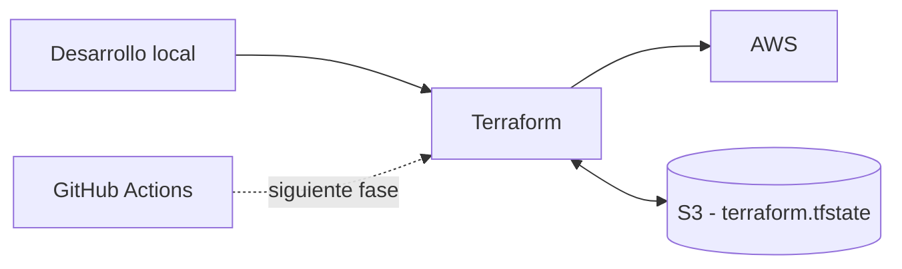

# Pipeline de Terraform con GitHub Actions y AWS

Proyecto práctico orientado a desplegar infraestructura en **AWS mediante Terraform** y automatizar posteriormente su ejecución a través de **GitHub Actions**.

La infraestructura se define como código y el estado de Terraform se almacena de forma remota en un bucket de Amazon S3. Esta decisión permite que el pipeline pueda ejecutarse desde runners efímeros de GitHub Actions sin depender de un archivo `terraform.tfstate` almacenado en un equipo local.

> **Estado del proyecto:** documentación en progreso. Este README recoge únicamente los pasos realizados hasta este punto.

---

## Objetivos

- Utilizar **Terraform** como herramienta de Infrastructure as Code (IaC).
- Aprovisionar infraestructura en **AWS**.
- Mantener el estado de Terraform de forma remota en **Amazon S3**.
- Proteger el estado mediante **versionado del bucket**.
- Utilizar módulos oficiales/comunitarios publicados en el **Terraform Registry**.
- Preparar el proyecto para su integración posterior con **GitHub Actions**.

---

## Arquitectura de trabajo



El bucket S3 actúa como **backend remoto**. Terraform consulta ese estado antes de calcular cambios y lo actualiza después de aplicar modificaciones en la infraestructura.

---

## 1. Autenticación en AWS

Antes de comenzar con Terraform se inició sesión en AWS CLI utilizando un perfil denominado `estudiante`:

```powershell
aws login --profile estudiante
```

El perfil se utiliza para trabajar con las credenciales obtenidas mediante AWS CLI.

Una comprobación habitual de la identidad autenticada es:

```powershell
aws sts get-caller-identity --profile estudiante
```

> Si se ejecuta `aws sts get-caller-identity` sin indicar el perfil y no existe un perfil por defecto configurado, AWS CLI puede responder con `Unable to locate credentials`. En ese caso se debe indicar `--profile estudiante` o establecer el perfil para la sesión.

---

## 2. Creación del backend remoto en Amazon S3

Terraform utiliza un archivo denominado `terraform.tfstate` para conocer el estado real de los recursos que administra.

En un proyecto ejecutado posteriormente mediante GitHub Actions no conviene depender de un estado local porque cada runner puede ser nuevo y efímero. Por ello se utiliza **Amazon S3 como backend remoto**.

El bucket del backend se crea antes de inicializar Terraform, ya que debe existir previamente para que Terraform pueda utilizarlo como almacenamiento de estado.

### 2.1 Creación del bucket

Se creó un bucket S3 de uso general en la región:

```text
Europa (Irlanda) - eu-west-1
```


Durante la configuración inicial se eligió un nombre asociado claramente a su función como almacén del estado de Terraform.


El nombre definitivo utilizado es:

```text
terraform-pipeline-demo-tfstate-project
```


### 2.2 Versionado del bucket

Se habilitó el **control de versiones de S3**.


Esto es especialmente importante para un backend de Terraform porque permite conservar versiones anteriores del archivo de estado. Si el estado se elimina accidentalmente o queda dañado, S3 conserva versiones anteriores que pueden servir para su recuperación.

---

## 3. Configuración del provider de AWS

Para administrar recursos de AWS desde Terraform se utiliza el provider oficial de HashiCorp.

Como buena práctica, se consultó el **Terraform Registry** para verificar la documentación oficial y la versión actual del provider antes de configurar el proyecto.


En el momento de realizar esta práctica se utilizó:

```text
hashicorp/aws 6.69.1
```

La propia documentación del Registry proporciona el bloque de configuración necesario:


Se creó el archivo `providers.tf` con la siguiente configuración:

```hcl
terraform {
  required_providers {
    aws = {
      source  = "hashicorp/aws"
      version = "6.69.1"
    }
  }
}

provider "aws" {
  # Configuration options
}
```


No se introducen claves de acceso directamente dentro del bloque `provider "aws"`. De esta manera se evita almacenar secretos en el código fuente. El provider de AWS obtiene las credenciales mediante los mecanismos de autenticación soportados por AWS, como el perfil/configuración disponible en el entorno desde el que se ejecuta Terraform.


> **Buena práctica:** las credenciales de AWS no deben escribirse en archivos `.tf` ni subirse al repositorio de GitHub.

---

## 4. Inicialización de Terraform

Una vez añadido el provider se ejecutó:

```powershell
terraform init
```


`terraform init` inicializa el directorio de trabajo y descarga los providers requeridos por la configuración.

En este caso Terraform localizó e instaló:

```text
hashicorp/aws v6.69.1
```

---

## 5. Configuración del backend S3

Se creó un archivo específico denominado:

```text
backend.tf
```

con la configuración del backend remoto:

```hcl
terraform {
  backend "s3" {
    bucket       = "terraform-pipeline-demo-tfstate-project"
    key          = "demo/pipeline.tfstate"
    use_lockfile = true
  }
}
```


### Parámetros utilizados

| Parámetro | Función |
|---|---|
| `bucket` | Bucket S3 donde se almacenará el estado de Terraform. |
| `key` | Ruta/nombre del objeto que contendrá el estado dentro del bucket. |
| `use_lockfile` | Activa el bloqueo del estado para reducir el riesgo de escrituras simultáneas. |

Con esta configuración, el estado queda almacenado en:

```text
s3://terraform-pipeline-demo-tfstate-project/demo/pipeline.tfstate
```

El bloqueo es importante cuando el proyecto se ejecuta desde un pipeline, ya que evita que dos ejecuciones intenten modificar simultáneamente el mismo estado.

---

## 6. Creación de la VPC mediante un módulo

Para la red se decidió utilizar un **módulo de Terraform** en lugar de definir manualmente todos los recursos relacionados con la VPC.

Se consultó el Terraform Registry y se utilizó el módulo:

```text
terraform-aws-modules/vpc/aws
```


El ejemplo de referencia utilizado parte de una configuración similar a:

```hcl
module "vpc" {
  source = "terraform-aws-modules/vpc/aws"

  name = "my-vpc"
  cidr = "10.0.0.0/16"

  azs             = ["eu-west-1a", "eu-west-1b", "eu-west-1c"]
  private_subnets = ["10.0.1.0/24", "10.0.2.0/24", "10.0.3.0/24"]
  public_subnets  = ["10.0.101.0/24", "10.0.102.0/24", "10.0.103.0/24"]
}
```

Los valores concretos del proyecto se están separando de la definición principal utilizando un archivo:

```text
locals.tf
```

Esto permite centralizar valores reutilizables y mantener una configuración más ordenada conforme aumenta el número de recursos.

> El contenido definitivo de `locals.tf` se documentará cuando se complete esta parte de la infraestructura.

---

## Estructura actual del proyecto

A estas alturas, la estructura lógica del proyecto contiene al menos:

```text
.
├── .gitignore
├── backend.tf
├── locals.tf
├── main.tf
└── providers.tf
```

### Responsabilidad de cada archivo

| Archivo | Responsabilidad |
|---|---|
| `providers.tf` | Define los providers y sus versiones. |
| `backend.tf` | Configura el almacenamiento remoto del estado en S3. |
| `locals.tf` | Centraliza valores locales reutilizables en la configuración. |
| `main.tf` | Contiene la definición principal de los recursos/módulos de infraestructura. |
| `.gitignore` | Evita versionar archivos locales o sensibles que no deben formar parte del repositorio. |

---

## Decisiones técnicas tomadas hasta ahora

### Estado remoto en S3

El estado no se mantiene únicamente en el equipo desde el que se desarrolla. Se almacena en S3 para que pueda ser utilizado tanto desde el entorno local como, posteriormente, desde GitHub Actions.

### Versionado del estado

El versionado del bucket permite conservar revisiones anteriores del `terraform.tfstate`, añadiendo una capa de recuperación frente a eliminaciones o modificaciones accidentales.

### Credenciales fuera del código

Las credenciales de AWS no forman parte de los archivos Terraform. Esto reduce el riesgo de publicar secretos accidentalmente en GitHub.

### Consulta de fuentes oficiales

Las versiones y ejemplos de providers y módulos se consultan directamente en el Terraform Registry antes de incorporarlos al proyecto.

### Uso de módulos

La VPC se construye mediante un módulo reutilizable, reduciendo código repetitivo y facilitando el mantenimiento de una infraestructura más compleja.

---

## Próximos pasos

La documentación continuará ampliándose a medida que avance el proyecto. Entre las siguientes fases estarán la finalización de la infraestructura Terraform y la integración del flujo con **GitHub Actions**.
