# Pipeline CI/CD de Terraform con GitHub Actions y AWS

> Proyecto creado por **Cristina Cañadas Gómez-Limón**.

Proyecto práctico de **Infrastructure as Code (IaC)** en el que se aprovisiona infraestructura en AWS mediante Terraform y se automatiza su ejecución con GitHub Actions.

El proyecto cubre el ciclo completo: autenticación, backend remoto en Amazon S3, definición de infraestructura mediante módulos, validación del despliegue en AWS, publicación del código en GitHub y creación de un pipeline CI/CD.

> **Objetivo principal:** disponer de un flujo reproducible en el que cada cambio enviado a `main` pueda inicializar Terraform, validar el formato y aplicar automáticamente la infraestructura sobre AWS.

---

## Índice

1. [Arquitectura del proyecto](#arquitectura-del-proyecto)
2. [Autenticación inicial en AWS](#1-autenticación-inicial-en-aws)
3. [Backend remoto en Amazon S3](#2-backend-remoto-en-amazon-s3)
4. [Provider de AWS](#3-configuración-del-provider-de-aws)
5. [Inicialización de Terraform](#4-inicialización-de-terraform)
6. [Configuración del backend](#5-configuración-del-backend-s3)
7. [Creación de la VPC mediante módulos](#6-creación-de-la-vpc-mediante-módulos)
8. [Plan y despliegue](#7-validación-y-despliegue-de-la-infraestructura)
9. [Comprobación en AWS](#8-comprobación-de-los-recursos-en-aws)
10. [Preparación del repositorio](#9-preparación-del-repositorio-github)
11. [Creación del workflow](#10-creación-del-workflow-de-github-actions)
12. [Versionado de Actions](#11-revisión-de-versiones-de-las-actions)
13. [Credenciales AWS](#12-autenticación-de-github-actions-con-aws)
14. [OIDC e IAM](#13-enfoque-recomendado-oidc--iam)
15. [Repository Secrets](#14-solución-utilizada-github-actions-secrets)
16. [Ejecución del pipeline](#15-ejecución-y-validación-del-pipeline)
17. [Workflow final](#workflow-final)
18. [Estructura del proyecto](#estructura-del-proyecto)
19. [Conclusiones y mejoras](#posibles-mejoras)

---

# Arquitectura del proyecto

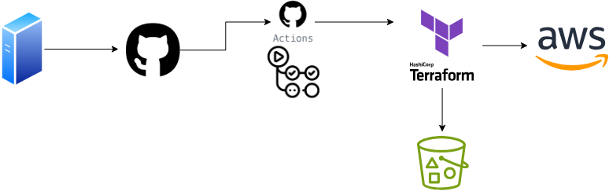

Terraform administra la infraestructura de AWS y utiliza un **backend remoto en Amazon S3** para guardar el estado. GitHub Actions actúa como motor de automatización: cuando se realiza un `push` a `main`, se ejecuta el workflow y Terraform trabaja contra el mismo estado remoto.

---

# 1. Autenticación inicial en AWS

Para comenzar se realiza la autenticación desde AWS CLI con el perfil de estudiante:

```powershell
aws login --profile estudiante
```

El perfil permite trabajar desde el entorno local sin introducir credenciales directamente en los archivos `.tf`.

Una comprobación habitual de la sesión es:

```powershell
aws sts get-caller-identity --profile estudiante
```

> Si se ejecuta el comando sin `--profile estudiante` y no existe un perfil por defecto, AWS CLI devuelve `Unable to locate credentials`.


---

# 2. Backend remoto en Amazon S3

Terraform utiliza el archivo `terraform.tfstate` para mantener una representación del estado de la infraestructura que gestiona.

Guardar este archivo únicamente en local no es adecuado para un pipeline porque los runners de GitHub Actions son efímeros. Por tanto, el estado se almacena de forma remota en **Amazon S3**.

## 2.1 Creación del bucket

Se crea un bucket S3 de uso general en la región:

```text
eu-west-1 — Europa (Irlanda)
```

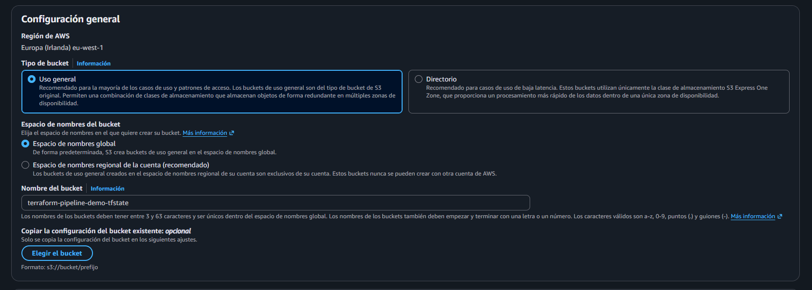

Se configura el bucket para utilizarlo exclusivamente como backend de Terraform.


El nombre definitivo utilizado es:

```text
terraform-pipeline-demo-tfstate-project
```

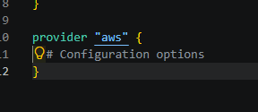

## 2.2 Versionado

Se habilita el **control de versiones** del bucket.

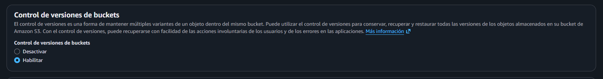

Esto permite conservar versiones anteriores del estado. Si el objeto `pipeline.tfstate` se elimina o se sobrescribe de forma incorrecta, S3 mantiene un historial que puede ayudar a recuperarlo.

> El versionado no sustituye una estrategia de backup completa, pero añade una capa de protección muy útil para el estado remoto.

---

# 3. Configuración del provider de AWS

Se consulta el **Terraform Registry** para utilizar el provider oficial de AWS y comprobar la versión disponible.

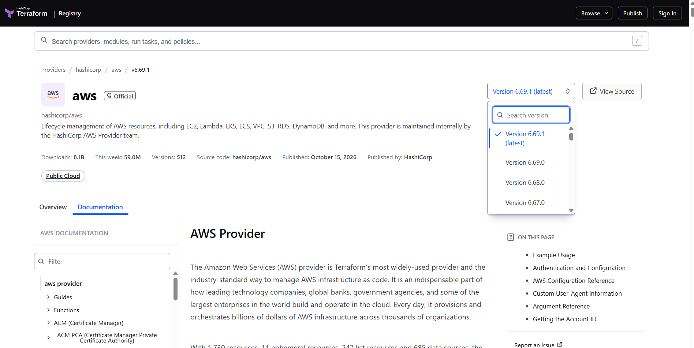

La documentación oficial muestra el bloque necesario para declarar el provider:

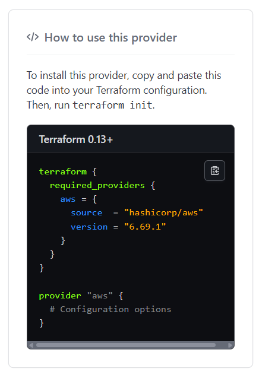

Se crea `providers.tf`:

```hcl
terraform {
  required_version = "~>1.16.5"
  required_providers {
    aws = {
      source  = "hashicorp/aws"
      version = "6.69.1"
    }
  }
}

provider "aws" {
  region = "eu-west-1"

  default_tags {
    tags = local.tags
  }
}
```

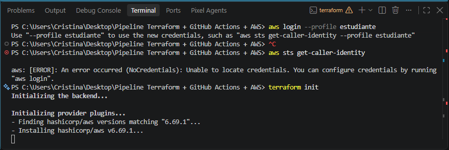

Las credenciales **no se incluyen en el código**:


Esto evita exponer claves en el repositorio y permite que Terraform utilice el mecanismo de autenticación disponible en cada entorno (perfil local en desarrollo, variables de entorno en GitHub Actions).

> `required_version` usa el operador `~>` (constraint pesimista): acepta `1.16.5` y cualquier parche posterior dentro de la misma versión menor, evitando que `terraform init` falle cada vez que se actualiza Terraform a un patch nuevo.

---

# 4. Inicialización de Terraform

Una vez configurado el provider se ejecuta:

```bash
terraform init
```

`terraform init` inicializa el directorio de trabajo, descarga los providers requeridos y prepara la configuración para poder utilizar módulos y backend remoto. La captura de la sección 1 ya muestra el arranque de este comando tras el login en AWS.

---

# 5. Configuración del backend S3

Se crea el archivo `backend.tf`:

```hcl
terraform {
  backend "s3" {
    bucket       = "terraform-pipeline-demo-tfstate-project"
    key          = "demo/pipeline.tfstate"
    use_lockfile = true
    region       = "eu-west-1"
  }
}
```

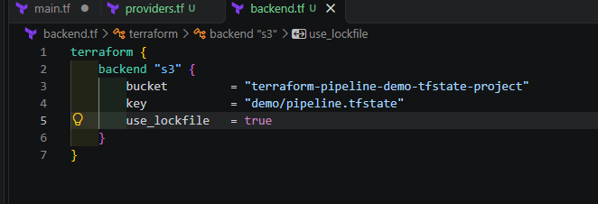

### Parámetros

| Parámetro | Función |
|---|---|
| `bucket` | Bucket S3 donde se guarda el estado. |
| `key` | Ruta del objeto que contiene el estado. |
| `use_lockfile` | Activa el bloqueo del estado para evitar escrituras concurrentes. |
| `region` | Región de AWS donde se encuentra el bucket. |

El estado queda almacenado en:

```text
s3://terraform-pipeline-demo-tfstate-project/demo/pipeline.tfstate
```

> Ni `providers.tf` ni `backend.tf` incluyen `profile`. Un perfil de AWS CLI local (como `estudiante`) solo existe en el equipo donde se configuró; en el runner de GitHub Actions no existe ese archivo, así que fijar un perfil en el código rompería el pipeline. En su lugar, Terraform recurre automáticamente a variables de entorno (`AWS_ACCESS_KEY_ID`, etc.), que cada entorno —local o CI— proporciona a su manera.

---

# 6. Creación de la VPC mediante módulos

Para construir la red se parte del módulo reutilizable del Terraform Registry:

```text
terraform-aws-modules/vpc/aws
```

> *(No se conserva una captura específica de la página del módulo en el Registry para esta sección.)*

En este proyecto el módulo se **vendorizó localmente** en `modules/vpc/` en lugar de referenciarlo directamente desde el Registry en cada `init`, de modo que `main.tf` lo invoca así:

```hcl
module "vpc" {
  source = "./modules/vpc"

  name = "${local.prefix}-vpc"
  cidr = "10.0.0.0/16"

  azs             = ["eu-west-1a", "eu-west-1b"]
  private_subnets = ["10.0.1.0/24", "10.0.2.0/24"]
  public_subnets  = ["10.0.101.0/24", "10.0.102.0/24"]

  enable_nat_gateway = true
}
```

El proyecto separa los valores reutilizables en `locals.tf`, mientras que `main.tf` contiene la llamada al módulo. Esto facilita mantener valores como:

- nombre del proyecto y entorno (`pipeline-demo-dev`);
- CIDR de la VPC;
- zonas de disponibilidad;
- subredes públicas y privadas;
- etiquetas comunes (`Environment`, `ManagedBy`, `Owner`, `Project`).

---

# 7. Validación y despliegue de la infraestructura

Después de configurar los módulos se vuelve a ejecutar `terraform init` para comprobar que Terraform puede resolver correctamente las dependencias del proyecto, y después se genera el plan y se aplica:

```bash
terraform plan
terraform apply
```

Terraform calcula los cambios y pide confirmación antes de aplicarlos:

```text
Plan: 23 to add, 0 to change, 0 to destroy.

Do you want to perform these actions?
  Terraform will perform the actions described above.
  Only 'yes' will be accepted to approve.

Enter a value: yes
```

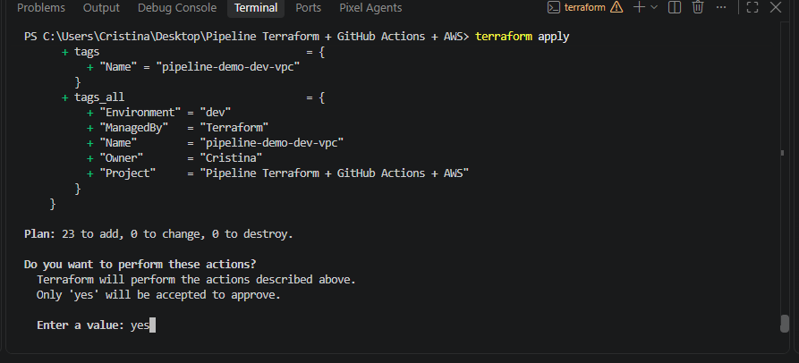

Esto indica que se van a crear 23 recursos nuevos y que no existen modificaciones ni eliminaciones sobre recursos previamente gestionados. Se confirma escribiendo `yes`.

---

# 8. Comprobación de los recursos en AWS

Una vez finalizado `terraform apply`, se comprueba desde la interfaz de AWS que los recursos han sido creados correctamente.

Esta verificación es importante porque no basta con que Terraform finalice sin errores: también se valida que el estado remoto existe y que la infraestructura desplegada coincide con lo esperado.

## 8.1 Estado remoto en S3

En el bucket aparece la ruta `demo/`, inicialmente vacía antes del primer `apply`:

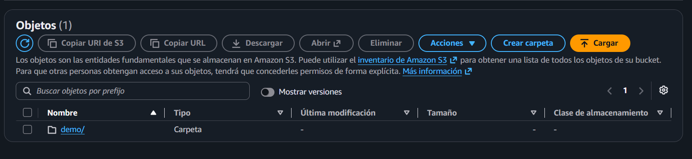

Tras aplicar la infraestructura, dentro se encuentra el archivo de estado:

```text
pipeline.tfstate
```

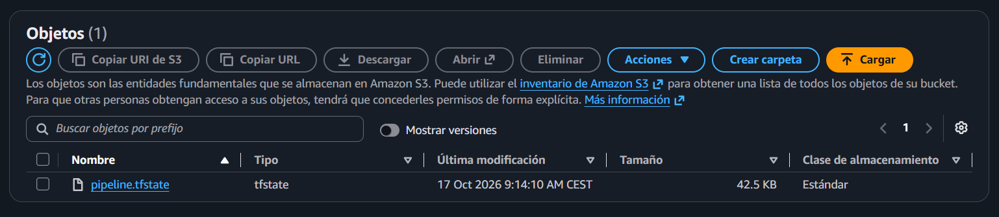

AWS muestra el objeto almacenado en:

```text
s3://terraform-pipeline-demo-tfstate-project/demo/pipeline.tfstate
```

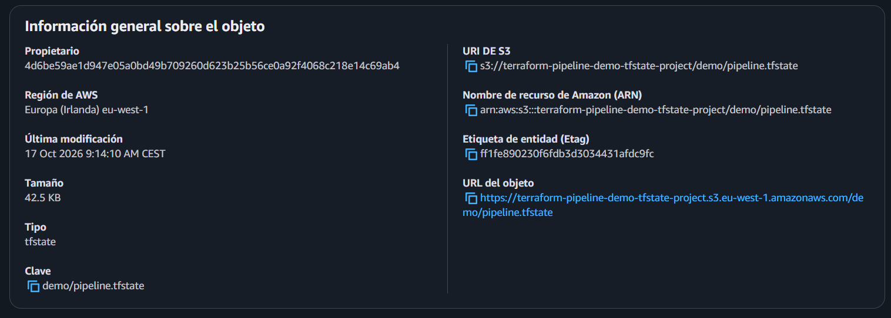

Esto confirma que Terraform ya no depende únicamente del estado local.

## 8.2 VPC y recursos de red

También se verifica desde la consola de VPC que la red se ha creado correctamente, incluyendo subredes, tablas de enrutamiento y conexiones asociadas.

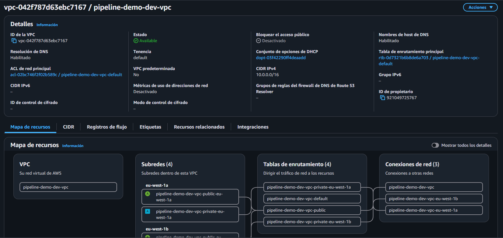

---

# 9. Preparación del repositorio GitHub

Una vez comprobada la infraestructura en AWS, el siguiente paso es subir el proyecto a GitHub para automatizarlo con GitHub Actions.

## 9.1 `.gitignore`

Antes de realizar el `push` se revisa la plantilla oficial de `.gitignore` para Terraform (del repositorio [`github/gitignore`](https://github.com/github/gitignore)).

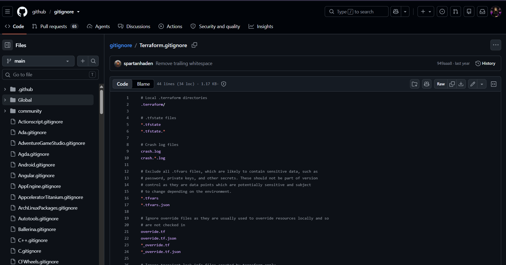

El objetivo es evitar subir al repositorio archivos locales, estados y datos que puedan contener información sensible.

Entre los patrones habituales se encuentran:

```gitignore
.terraform/
*.tfstate
*.tfstate.*
crash.log
crash.*.log
*.tfvars
*.tfvars.json
override.tf
override.tf.json
*_override.tf
*_override.tf.json
```

El archivo `.terraform.lock.hcl` sí puede mantenerse versionado para fijar las versiones seleccionadas de los providers.

---

# 10. Creación del workflow de GitHub Actions

Desde la pestaña **Actions** del repositorio se consultan las plantillas disponibles:

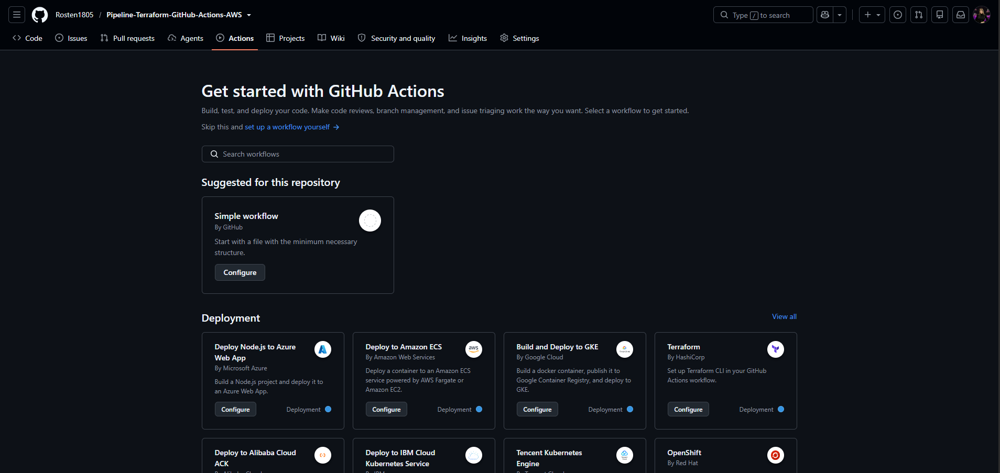

Se selecciona la plantilla de **Terraform by HashiCorp**:

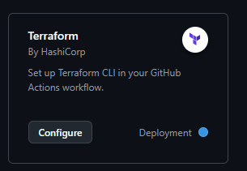

GitHub proporciona un workflow inicial con los pasos básicos necesarios, que se adapta progresivamente al proyecto.

> *(No se conserva la captura del workflow base generado por la plantilla; el archivo original se perdió durante la práctica. El resultado final adaptado está documentado íntegro en la sección [Workflow final](#workflow-final).)*

En el proyecto local se crea la estructura:

```text
.github/
└── workflows/
    └── pipeline-tf.yaml
```

También sería válido utilizar la extensión `.yml`.

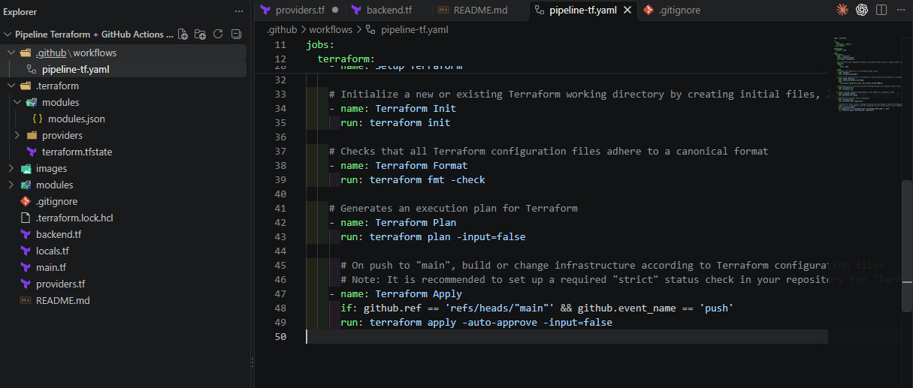

Dentro de `pipeline-tf.yaml` se pega el workflow de referencia y se adapta al proyecto.

---

# 11. Revisión de versiones de las Actions

No se toma como definitiva la versión incluida en una plantilla. Se comprueba el repositorio oficial de cada Action antes de fijarla.

## 11.1 Checkout

La plantilla mostraba inicialmente:

```yaml
uses: actions/checkout@v4
```

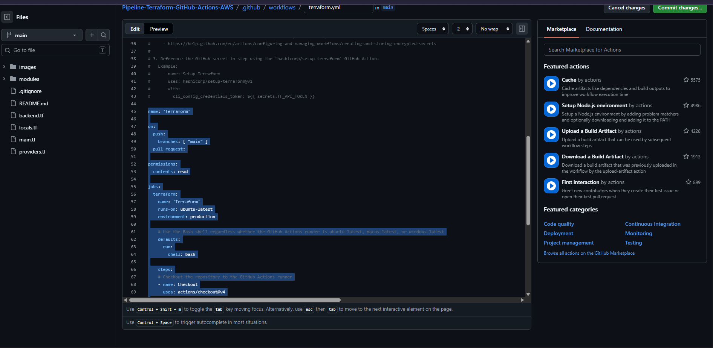

Se consulta el repositorio oficial y se comprueba la versión disponible:

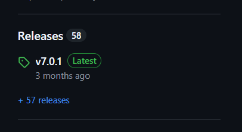

El workflow del proyecto utiliza finalmente:

```yaml
uses: actions/checkout@v7
```

## 11.2 Setup Terraform

Se realiza la misma comprobación con `hashicorp/setup-terraform`.

La plantilla de referencia incluía:

```yaml
uses: hashicorp/setup-terraform@v1
```

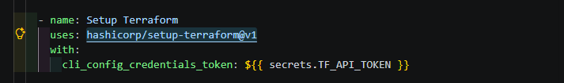

El repositorio oficial muestra versiones posteriores disponibles:

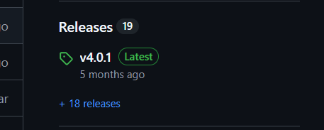

> **Nota:** en el workflow final se mantuvo `hashicorp/setup-terraform@v1`, ya que fue la versión con la que se probó y validó el pipeline. Como mejora pendiente, convendría actualizarla a una versión más reciente y volver a validar la ejecución.

---

# 12. Autenticación de GitHub Actions con AWS

El runner de GitHub necesita credenciales válidas para ejecutar Terraform contra AWS. Se añade un paso de configuración de credenciales usando la action oficial:

```yaml
- name: Configure AWS Credentials
  uses: aws-actions/configure-aws-credentials@v6
  with:
    aws-access-key-id: ${{ secrets.AWS_ACCESS_KEY_ID }}
    aws-secret-access-key: ${{ secrets.AWS_SECRET_ACCESS_KEY }}
    aws-session-token: ${{ secrets.AWS_SESSION_TOKEN }}
    aws-region: eu-west-1
```

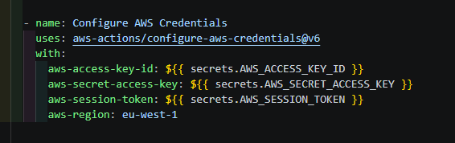

Las credenciales **nunca se escriben directamente dentro del YAML**: la action las lee desde GitHub Actions Secrets (`secrets.*`) y las inyecta como variables de entorno en el runner, que es donde Terraform las recoge automáticamente.

---

# 13. Enfoque recomendado: OIDC + IAM

En un entorno real es preferible evitar credenciales AWS de larga duración almacenadas como secretos. La alternativa recomendada es establecer una relación de confianza entre GitHub Actions y AWS mediante **OpenID Connect (OIDC)**, sin necesidad de copiar ninguna clave de acceso.

Se accede a IAM y se revisan los proveedores de identidad existentes:


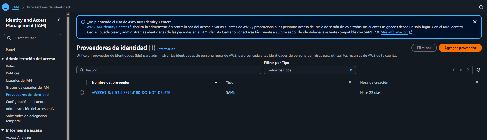

La documentación de GitHub para AWS indica los valores a usar:

```text
Provider URL:
https://token.actions.githubusercontent.com

Audience:
sts.amazonaws.com
```

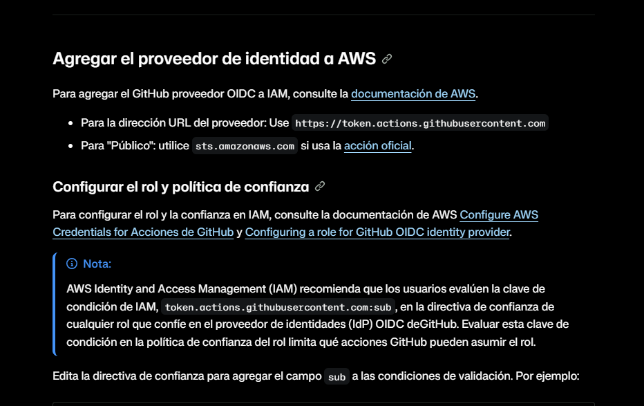

Se intentó crear en IAM un proveedor **OpenID Connect** con esos valores:

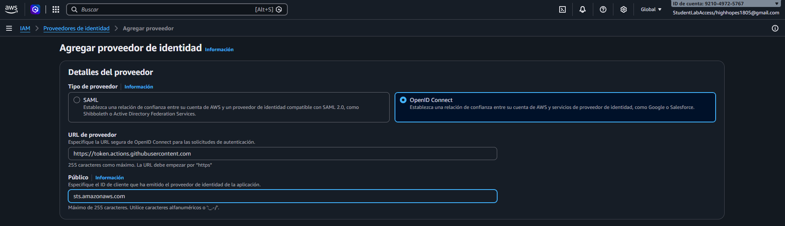

**Este paso falló.** La cuenta de AWS Academy / Learner Lab utilizada opera a través de un rol de IAM Identity Center (`AWSReservedSSO_StudentLabAccess...`) sin permisos para `iam:CreateOpenIDConnectProvider`:

```text
User: arn:aws:sts::<cuenta>:assumed-role/AWSReservedSSO_StudentLabAccess_.../<usuario>
is not authorized to perform: iam:CreateOpenIDConnectProvider on resource:
arn:aws:iam::<cuenta>:oidc-provider/token.actions.githubusercontent.com
because no identity-based policy allows the iam:CreateOpenIDConnectProvider action
```

Se exploró igualmente cómo habría sido el siguiente paso (crear un rol con el proveedor de GitHub como entidad de confianza), a modo de documentación, aunque el proveedor en sí nunca llegó a crearse:

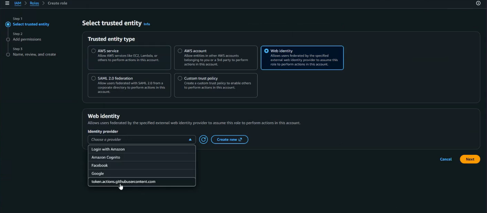

## Principio de mínimo privilegio

Durante la exploración del asistente se observó la opción de asignar `AdministratorAccess`:

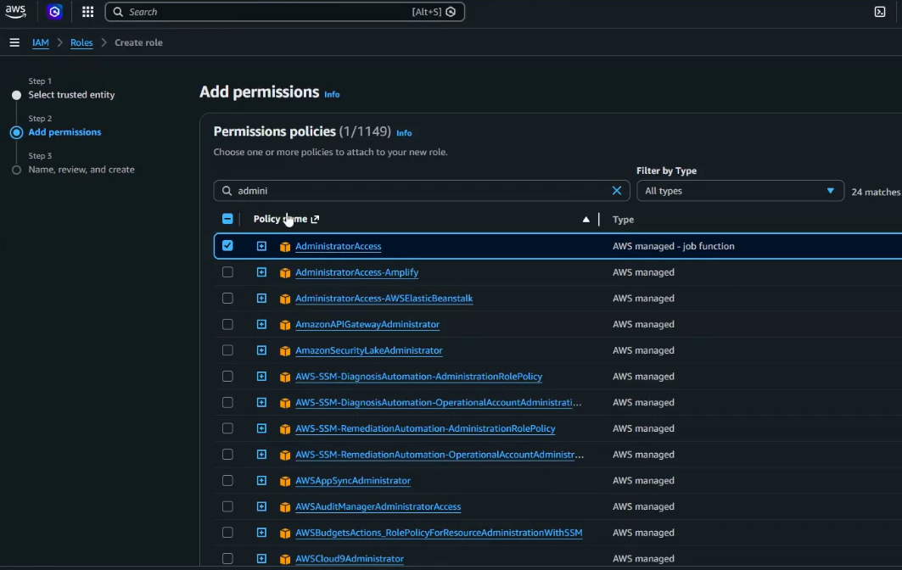

Conceder permisos de administrador a un pipeline es una mala práctica para un entorno real, incluso si el flujo OIDC hubiera podido completarse. El enfoque correcto consiste en aplicar el **principio de mínimo privilegio**: el rol debe disponer únicamente de los permisos estrictamente necesarios para los recursos que Terraform tenga que crear o modificar, y en producción convendría además limitar la política de confianza OIDC mediante condiciones sobre el repositorio, rama o environment permitido.

---

# 14. Solución utilizada: GitHub Actions Secrets

Al no ser viable OIDC con esta cuenta de estudiante, se optó por **GitHub Actions Repository Secrets**, usando las credenciales temporales (access key, secret key y session token) que proporciona el Learner Lab / portal de acceso de AWS IAM Identity Center.

Ruta:

```text
Settings
→ Secrets and variables
→ Actions
→ Repository secrets → New repository secret
```

> *(No se conserva una captura de esta pantalla concreta.)*

Se crean tres secrets, uno por valor, sin ningún texto adicional dentro de cada campo:

```text
AWS_ACCESS_KEY_ID
AWS_SECRET_ACCESS_KEY
AWS_SESSION_TOKEN
```

Los valores se almacenan cifrados (no se pueden volver a leer una vez guardados) y el workflow los referencia mediante:

```yaml
${{ secrets.NOMBRE_DEL_SECRETO }}
```

> Esta solución permite completar el laboratorio, pero el diseño recomendado para un entorno profesional sería **OIDC + IAM Role** con permisos mínimos, evitando credenciales estáticas o temporales copiadas manualmente al repositorio. Al tratarse de credenciales temporales del Learner Lab, además caducan a las pocas horas: hay que repetir este proceso (relanzar el Lab y actualizar los 3 secrets) cada vez que se quiera volver a ejecutar el pipeline tras una caducidad.

---

# 15. Ejecución y validación del pipeline

Una vez subido el workflow, GitHub Actions detecta el archivo automáticamente y lo ejecuta en cada `push` a `main`.

Durante la puesta en marcha se realizaron varios ajustes, visibles en las primeras ejecuciones:

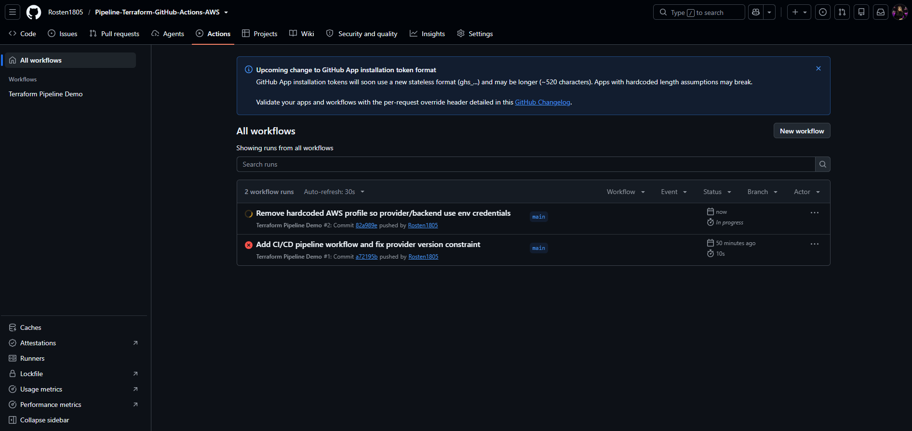

Entre los ajustes necesarios:

- eliminar las referencias a `profile = "estudiante"` en `providers.tf` y `backend.tf`, ya que ese perfil solo existe en el equipo local y no en el runner de GitHub Actions;
- corregir el `required_version` de Terraform para que coincidiera con una versión realmente disponible;
- ajustar el formato canónico de los archivos `.tf` mediante `terraform fmt`, ya que `terraform fmt -check` hacía fallar el pipeline.

Finalmente el workflow finaliza correctamente:

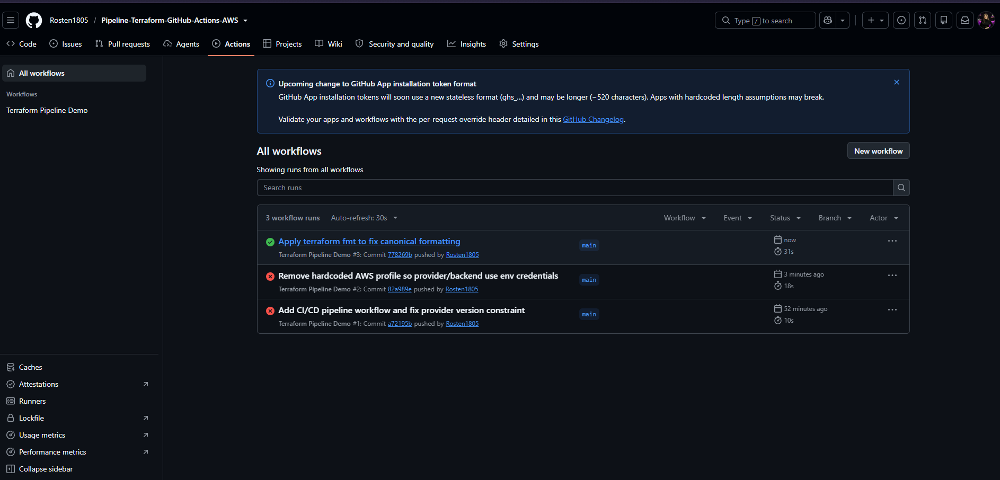

La ejecución en verde confirma que GitHub Actions ha podido autenticarse en AWS, inicializar Terraform contra el backend S3, validar el formato y aplicar la infraestructura de principio a fin.

---

# Workflow final

El workflow utilizado en la práctica, tal y como queda en `.github/workflows/pipeline-tf.yaml`:

```yaml
name: 'Terraform Pipeline Demo'

on:
  push:
    branches: [ "main" ]

permissions:
  contents: read

jobs:
  ci-cd-tf:
    name: 'CI/CD Terraform'
    runs-on: ubuntu-latest
    steps:
    - name: Checkout
      uses: actions/checkout@v7

    - name: Setup Terraform
      uses: hashicorp/setup-terraform@v1
      with:
        terraform_version: 1.16.5
        cli_config_credentials_token: ${{ secrets.TF_API_TOKEN }}

    - name: Configure AWS Credentials
      uses: aws-actions/configure-aws-credentials@v6
      with:
        aws-access-key-id: ${{ secrets.AWS_ACCESS_KEY_ID }}
        aws-secret-access-key: ${{ secrets.AWS_SECRET_ACCESS_KEY }}
        aws-session-token: ${{ secrets.AWS_SESSION_TOKEN }}
        aws-region: eu-west-1

    - name: Terraform Init
      run: terraform init

    - name: Terraform Format
      run: terraform fmt -check

    - name: Terraform Apply
      if: github.ref == 'refs/heads/main' && github.event_name == 'push'
      run: terraform apply -auto-approve -input=false
```

## Flujo del pipeline

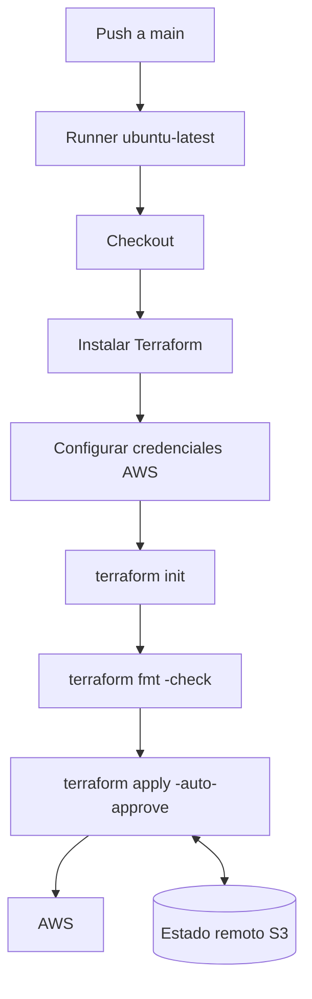

---

# Estructura del proyecto

```text
.
├── .github/
│   └── workflows/
│       └── pipeline-tf.yaml
├── images/
├── modules/
│   └── vpc/
├── .gitignore
├── .terraform.lock.hcl
├── backend.tf
├── locals.tf
├── main.tf
├── providers.tf
└── README.md
```

> `.terraform/` y los ficheros `*.tfstate*` locales no se versionan (ver `.gitignore`).

---

# Qué aporta cada archivo

| Archivo | Función |
|---|---|
| `providers.tf` | Define el provider de AWS, su versión y la versión mínima de Terraform. |
| `backend.tf` | Configura Amazon S3 como backend remoto del estado. |
| `locals.tf` | Centraliza valores reutilizables del proyecto (entorno, proyecto, tags). |
| `main.tf` | Declara el módulo de VPC y los recursos principales. |
| `.terraform.lock.hcl` | Registra las selecciones concretas de providers. |
| `.gitignore` | Evita versionar estados, cachés y archivos sensibles. |
| `.github/workflows/pipeline-tf.yaml` | Define el pipeline CI/CD. |

---

# Decisiones técnicas relevantes

| Decisión | Motivo |
|---|---|
| Estado remoto en S3 | Permite compartir el estado entre ejecuciones y runners efímeros. |
| Versionado de S3 | Facilita recuperar versiones anteriores del estado. |
| `use_lockfile = true` | Reduce el riesgo de modificaciones simultáneas del estado. |
| `required_version = "~>1.16.5"` | Evita que `terraform init` falle por un patch nuevo de Terraform; solo bloquea saltos de versión menor/mayor. |
| Módulo de VPC vendorizado | Evita repetir infraestructura de red y fija una copia local estable del módulo. |
| `.gitignore` oficial | Reduce el riesgo de subir estado o secretos al repositorio. |
| Sin `profile` en `providers.tf`/`backend.tf` | El perfil local no existe en el runner de GitHub Actions; las credenciales llegan por variables de entorno en cada entorno. |
| GitHub Actions | Automatiza la aplicación de la infraestructura en cada push a `main`. |
| Repository Secrets | Solución utilizada por las restricciones de permisos de la cuenta de laboratorio. |
| OIDC + IAM | Alternativa recomendada para un entorno profesional; no viable con esta cuenta de estudiante. |
| Mínimo privilegio | Limita el impacto potencial de una credencial o pipeline comprometido. |

---

# Problemas encontrados y aprendizaje

Durante la construcción del proyecto aparecieron varios problemas que forman parte del aprendizaje:

### Perfil AWS local

Una configuración que funciona en local puede fallar dentro de GitHub Actions si depende de un perfil existente únicamente en el equipo del desarrollador. El runner de GitHub necesita su propio mecanismo de autenticación (variables de entorno, en este caso).

### Versión de Terraform no disponible

`required_version` puede fijar una versión de Terraform que todavía no está disponible en el entorno de ejecución (por ejemplo, una versión más nueva que la instalada). `terraform init` falla con `Unsupported Terraform Core version` hasta que el constraint se ajusta a una versión realmente instalada.

### Formato de Terraform

El pipeline incluye:

```bash
terraform fmt -check
```

Esto hace que el workflow falle cuando los archivos `.tf` no cumplen el formato canónico. La solución es ejecutar:

```bash
terraform fmt
```

antes de realizar el `push`.

### Versiones de Actions

Las plantillas generadas automáticamente pueden contener versiones anteriores de las Actions. Conviene comprobar sus repositorios oficiales antes de fijarlas.

### Permisos IAM restringidos en cuentas de estudiante

Las cuentas de AWS Academy / Learner Lab operan con un rol de acceso (`AWSReservedSSO_StudentLabAccess...`) que no permite crear proveedores de identidad OIDC ni roles IAM personalizados. Conviene comprobarlo pronto, antes de invertir tiempo en configurar un flujo que la cuenta no podrá completar.

### `-auto-approve` sin `-input=false`

En un pipeline no interactivo, `terraform apply -auto-approve` sin `-input=false` puede quedarse colgado esperando una variable sin valor por defecto, ya que el runner no puede responder a un prompt. Añadir `-input=false` hace que falle inmediatamente en vez de bloquearse.

---

# Posibles mejoras

Este laboratorio funciona, pero todavía hay mejoras importantes antes de considerarlo un pipeline preparado para producción:

1. Migrar definitivamente la autenticación a **GitHub OIDC + IAM Role** (requiere una cuenta con permisos IAM suficientes).
2. Sustituir `AdministratorAccess` por políticas de **mínimo privilegio**.
3. Actualizar `hashicorp/setup-terraform` a una versión actual compatible.
4. Añadir `terraform validate`.
5. Ejecutar `terraform plan` en Pull Requests, antes de hacer merge a `main`.
6. Reservar `terraform apply` para `main` o para un environment protegido.
7. Añadir aprobación manual antes de producción.
8. Separar entornos `dev`, `staging` y `prod`.
9. Incorporar análisis de seguridad IaC, por ejemplo Checkov, tfsec o Trivy.
10. Añadir protección de ramas y revisiones obligatorias.

---

# Resultado

El proyecto permite pasar de una configuración Terraform ejecutada localmente a un flujo automatizado:

```text
Código Terraform
      ↓
GitHub
      ↓
GitHub Actions
      ↓
Terraform
      ↓
AWS
      ↕
Estado remoto en S3
```

Se ha validado tanto la creación de los recursos en AWS como el almacenamiento remoto del estado y la ejecución correcta del pipeline desde GitHub Actions.

---

## Referencias

- Terraform Registry — AWS Provider
- Terraform Registry — AWS VPC Module
- GitHub Actions — Terraform
- GitHub Actions — OIDC en AWS
- AWS IAM — Identity Providers
- AWS S3 — Versioning
